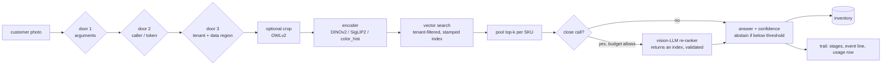

# Visual Product Search


Identify **which catalogue product (SKU)** is in a customer's photo, with **no label, barcode or serial number**,
then check live stock. Image-to-image retrieval with an optional vision-LLM re-ranker, exposed as a FastAPI
service **and** an MCP tool for agents, wrapped in the engineering that makes it safe to run: multi-tenancy,
auth, versioned catalogue, eval gate, cost controls and full traceability.



**Why image-to-image:** describing the photo in text and searching with that text loses the fine visual detail that
separates look-alike SKUs. Published comparisons put text-prompt matching far below image-embedding matching on the same
products, so this design embeds images on both sides and only uses a language model to *re-rank* a short list.

## 1. Run it (offline: no download, no network)

```
pip install -r requirements.txt
cp .env.example .env              (Windows: copy .env.example .env) -- keeps VPI_ENCODER=color_hist
python tasks.py test              34 tests, about 30 seconds
python tasks.py data              draws a synthetic catalogue + "customer photos" (busy background, rotation, blur)
python tasks.py build             puts the catalogue into the index
python tasks.py eval              metrics + the miss list
```

`python tasks.py` with no target lists every target (a cross-platform stand-in for `make`).

| Result on the synthetic set (`color_hist` toy encoder) | Value |
|---|---|
| recall@1 / recall@5 / recall@10 | 0.778 / 0.933 / 1.000 |
| index self-match rate | 1.00 |
| eval gate | **FAIL (by design)**: the toy encoder cannot reject out-of-catalogue photos, and `calibrate` reports that no threshold meets the targets. The harness refuses to bless a weak model; switch `VPI_ENCODER=dinov2_small` and rerun `build -> calibrate -> gate`. |

## 2. What to read, in this order

| # | File | What you learn there |
|---|------|----------------------|
| 1 | [shared/schemas.py](shared/schemas.py) | the shape of every answer, error (`Refused`) and usage row |
| 2 | [shared/settings.py](shared/settings.py) | every knob in one place; `.env` changes them |
| 3 | [services/api/identify.py](services/api/identify.py) | **THE pipeline**, steps 1–8; everything else serves this file |
| 4 | [services/api/guards.py](services/api/guards.py) → [shared/auth.py](shared/auth.py) → [shared/tenancy.py](shared/tenancy.py) | the three doors: arguments → caller → tenant |
| 5 | [services/vision/](services/vision/) `encoders.py`, `index.py`, `detector.py` | photo → vector → nearest catalogue images |
| 6 | [services/rerank/](services/rerank/) `reranker.py`, `budget.py` | the optional AI judge, its validators, cache and budget breaker |
| 7 | [shared/ledger.py](shared/ledger.py) + [commands/catalog.py](commands/catalog.py) | catalogue versions: build, retire, withdraw, restore, status |
| 8 | [evals/evaluate.py](evals/evaluate.py), `calibrate.py`, `gate.py`, `ablate.py` | measuring: metrics, threshold, PASS/FAIL, one knob per arm |
| 9 | [shared/events.py](shared/events.py), [shared/usage.py](shared/usage.py), [commands/trace.py](commands/trace.py), [evals/usage_report.py](evals/usage_report.py) | the trail, the usage rows, and their readers |
| 10 | [services/api/app.py](services/api/app.py), [services/mcp_server/server.py](services/mcp_server/server.py) | the two surfaces: both are thin wrappers over guards.py |
| 11 | [tests/](tests/) | each test is a small, runnable example of one rule |

## 3. Layout

```
shared/            settings, schemas, auth (door 2), tenancy (door 3 + data_region), ledger, events, usage, images (door 1)
services/vision/   encoders (image → vector), index (search, tenant filter), detector (optional crop)
services/rerank/   reranker (OpenRouter or local model, validators, cache), budget (router clocks + breaker)
services/inventory stock table lookup (deterministic, never cached)
services/api/      identify.py (the pipeline), guards.py (doors), runtime.py (load once), app.py (FastAPI)
services/mcp_server/ server.py: identify_product + check_inventory as MCP tools
evals/             sample_data, evaluate, calibrate, gate, ablate, usage_report
commands/          catalog (build/retire/withdraw/restore/status), trace, probe_index
smoke/             smoke_api, smoke_mcp: test RUNNING servers (success + refusal per door)
tests/             offline unit tests (toy encoder, fake re-ranker: no network)
data/synthetic/    everything the scripts write (one folder per dataset; delete it any time)
```

## 4. The models

| Setting `VPI_ENCODER` | Download | Purpose |
|---|---|---|
| `color_hist` | none | a toy model so you can run every step today; **not accurate** |
| `dinov2_small` | ~90 MB | the real local default: learned shapes/textures without captions |
| `siglip2_base` | ~375 MB | learned from image–caption pairs; the ablation compares it with DINOv2 |
| `dinov2_large`, `siglip2_so400m` | GBs | **Colab only** |

`VPI_DETECTOR=owlv2` turns on cropping (~600 MB, slow on CPU). `VPI_RERANKER` is `none`,
`openrouter:<model>:free` (the photo leaves this machine, and only for tenants with `data_region: any`), or `local:<hf id>` (Colab GPU).
For the real encoders: `pip install transformers==5.20.1`. For OpenRouter: `pip install openai==3.35.1` and set the key in `.env`.

## 5. Production practices and where they live

| # | Practice | Here |
|---|----------|------|
| 1 | one implementation behind every surface | `identify()`; API, MCP and evals all call it |
| 2 | tool = typed function + docstring | `services/mcp_server/server.py` |
| 3 | arguments → caller → tenant | `guards.py`; tested in `tests/test_guards.py` |
| 4 | errors as data | `Refused(code, message, hint, door)`, returned as JSON by both surfaces |
| 5 | log refusals too | `guards._refused()`: event line + usage row with `refused` |
| 6 | answer carries its trail | `Stages` in every answer; `image_id = tenant:sku:<sha256>` |
| 7 | first broken mark = cause | `python tasks.py trace` |
| 8 | named fallback events | `crop_fallback`, `rerank_fallback`, `policy_fallback`, `budget_fallback`, `budget_strict`, `index_stamp_mismatch` |
| 9 | one usage row per request, priced at write | `shared/usage.py` |
| 10 | reconcile additive measures | `python tasks.py report` → `reconciles: YES` |
| 11 | router + breaker, degrade never stop | `identify.choose_reranker()` + `rerank/budget.py` (strict at 80%) |
| 12 | replay, never touch live | `VPI_SPEND_PCT`; `VPI_DATA_DIR` per dataset |
| 13 | ablation, one knob per arm | `python tasks.py ablate`; miss list `ranked out` / `not retrieved at depth N` |
| 14 | golden set + required rows + gate | `golden.jsonl`, `python tasks.py gate` (exit 1 on FAIL) |
| 15 | versions by bytes; ledger; undo; status | `shared/ledger.py`, `commands/catalog.py` |
| 16 | stamp on every vector | `encoder@revision|tta`; mismatch refused |
| 17 | model output = an index, validated | `reranker.parse_choice()` |
| 18 | data_region per tenant, fail closed | `tenancy.policy_of()`: missing or unknown → `in` |
| 19 | check before spend; cache by hash | `breaker.take()` before the call; `rerank_cache/` keyed by sha256 |
| 20 | hashes, not content, in logs | `query_sha`; the photo is never logged |
| 21 | smoke: success AND refusal per door | `smoke/smoke_api.py`, `smoke/smoke_mcp.py` |
| 22 | read-only probes | `tasks.py status`, `tasks.py probe` |
| 23 | nothing left warm | models load on first use; no server starts unless you run `serve`/`mcp` |
| 24 | known-gaps box | section 8 below |
| 25 | verify checklist | section 7 below |

Note: the crop setting is recorded in `stages.crop` rather than in the index stamp, because only the customer
photo is cropped, never the catalogue.

## 6. Running the servers (only when you choose to)

```
python tasks.py serve        API on http://localhost:8080/docs   (Ctrl+C stops it)
python tasks.py smoke        in a second terminal: 8 checks, success + refusal per door
pip install fastmcp==4.1.1
python tasks.py mcp          MCP server on http://localhost:9000/mcp
python tasks.py smoke-mcp    tools discovered, success, refusal at the caller door
```
Test tokens live in `data/synthetic/dev_tokens.json`: `dev-token` (API), `dev-mcp-token` (MCP), `acme-token`
(another tenant), and two that must be refused (`no-email-token`, `other-service-token`).

## 7. Verify it yourself (exact values from the synthetic set, `VPI_ENCODER=color_hist`)

| Command | Pass value |
|---|---|
| `python tasks.py test` | `34 passed, 1 skipped` (the skip is the MCP test until fastmcp is installed) |
| `python tasks.py data` | `15 SKUs (30 catalogue images), 53 queries (8 out-of-catalogue)` |
| `python tasks.py build` (twice) | first `"embedded": 30`; second `"embedded": 0` (idempotent) |
| `python tasks.py eval` | `top1 0.7778`, `recall@5 0.9333`, `failed_rows 0` |
| `python tasks.py ablate` | `use_flip_tta=false` row: top1 `0.8444` (flip TTA *hurts* on this toy data) |
| `python tasks.py status` | `"status": "in sync"`; after `retire --tenant practice --sku PRD-001`: `drift`, 28 vs 30 |
| `python tasks.py probe` | self-match rate `practice 1.0, acme 1.0` |
| `python tasks.py report` | `reconciles (per-tenant sums == totals): YES` |
| `python tasks.py gate` | **`GATE FAILED`, and that is expected**: see the next paragraph |

Why the gate fails with the toy model: the "not sure" threshold is still 0, so it answers every
out-of-catalogue photo (false-accept 1.0), and two required photos are wrong. `calibrate` then reports that **no
threshold meets the targets**. That is the harness doing its job: it refuses to bless a weak model. The next step
is to switch the encoder to `dinov2_small` and rerun `build`, `ablate`, `calibrate` and `gate`.

## 8. What this does not do yet (known gaps)

- **Accuracy is unproven.** The synthetic set tests the *code*; accuracy has to be measured on real photos of the target catalogue (the same harness runs on Colab with the bigger encoders).
- **`dinov2_small`, `siglip2_base`, `owlv2`, OpenRouter and the local re-ranker paths are not exercised by the offline test suite**: it uses a toy encoder and a fake re-ranker. The fake re-ranker in the tests covers the logic around them, not the model calls themselves.
- The MCP server and the smoke tests need `fastmcp` and a running server; they are not part of the offline suite.
- The vector index is exact numpy search: fine to about 100k images. Swapping in a vector database only changes `index.py`.
- Local dev tokens are not security; they imitate the checks a Google ID token gets. `VPI_AUTH_MODE=google` is written but untested.
- Budget counters live in memory per process (two processes = two counters). They are seeded from `usage.jsonl` at start.
- Events and usage are JSONL files with no rotation. On Cloud Run they become Cloud Logging.
- There is no UI here, and inventory is a local table: swap `services/inventory/stock.py` for your system of record.
- A threshold calibrated on about 50 rows is a demonstration, not a decision.

## 9. Colab profile (later, once the code makes sense)

The same folder, uploaded to Colab, with `.env`:
```
VPI_PROFILE=colab
VPI_ENCODER=siglip2_so400m      (or dinov2_large: whichever the 07 notebook bake-off picked)
VPI_DETECTOR=owlv2
VPI_DATA_DIR=/content/data/<dataset>
```
Real data uses the same layout as `data/synthetic/`: `catalog_images/<tenant>/<sku>/*.jpg`, `catalog.csv`,
`inventory.csv`, `golden.jsonl`, `tenants.json`. Nothing in `services/` changes.

## License

MIT
